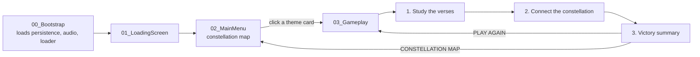
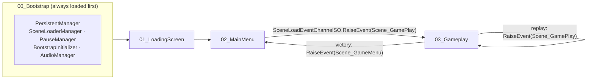
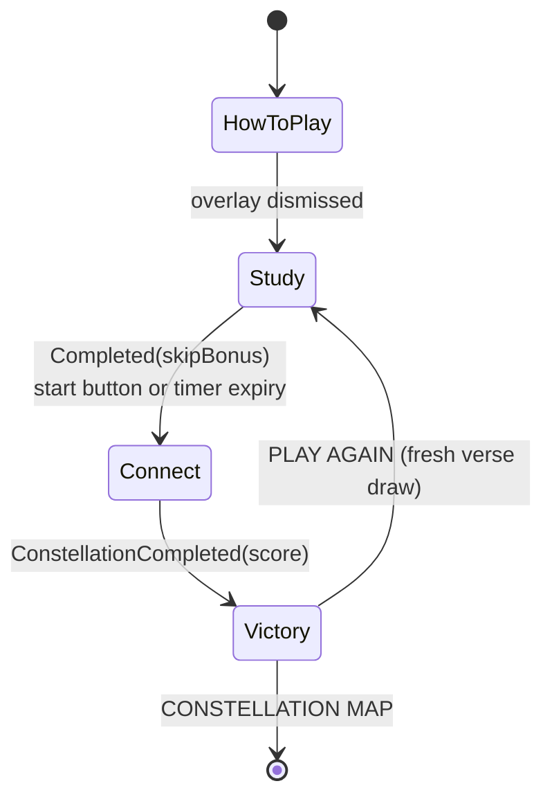
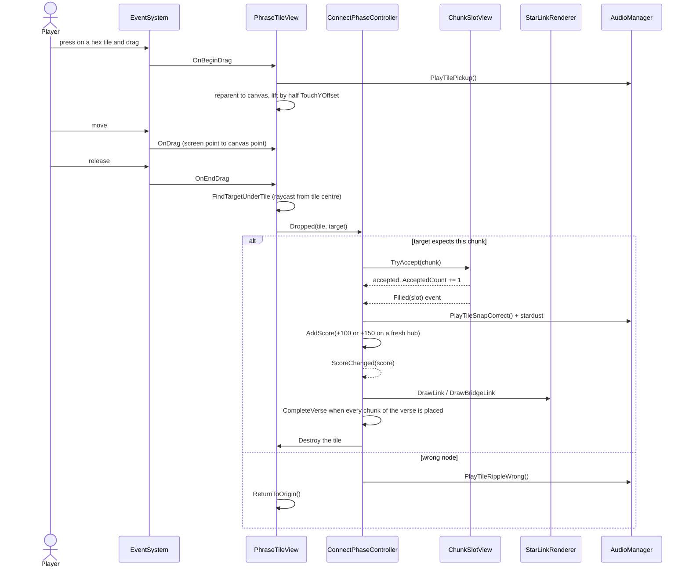
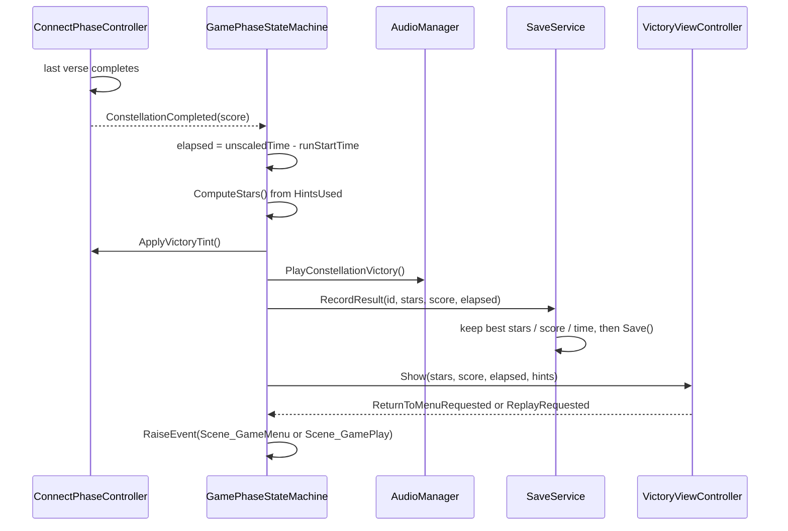
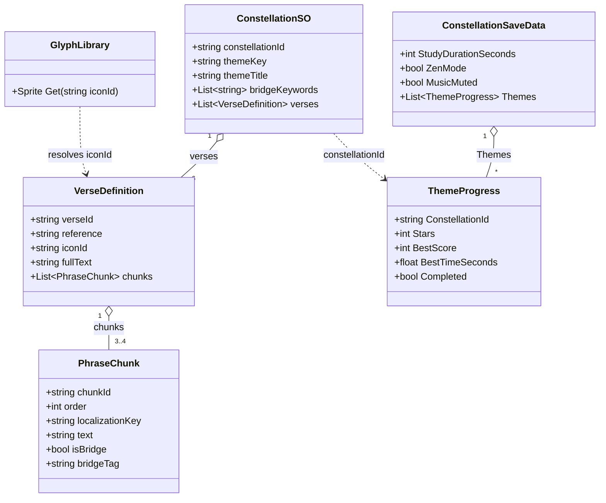
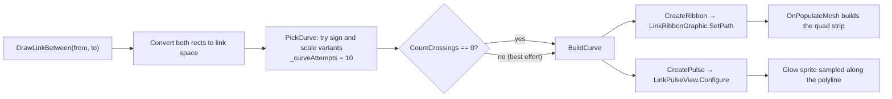
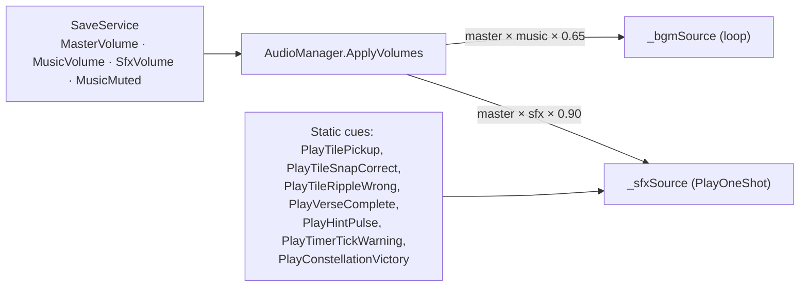
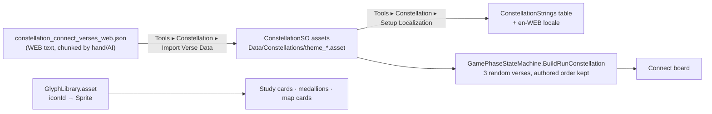

# Constellation Connect

A small scripture-memorisation puzzle built in Unity 6 (URP 2D). You study a handful of Bible
verses, then rebuild each one by dragging its phrase fragments onto the constellation of nodes on
screen — and every verse is tied to the next one through a shared keyword.


---

## Introduction

This game is an experiment I did to see what can be done with ai tools while having a human in the loop. It is not a finished product at all so please do not judge. I would love for this to eventually become a tool to help Christians memorize scripture. I developed the idea using Google Gemini, art generation also Gemini, sfx  and music Elevenlabs, building the app and coding Aura for Unity (used to be Coplay). The Bible verses used come from the WEB translation , which I used to avoid any type of copyright issues. My hope is that this project will be of use to other in learning what it looks like when AI creates alongside a human and that you will make up your own mind about it's effectiveness or the actual value of the end product. I myself am still deciding if this is really how I want to create. The rest of this document was generated by ai to describe the inner workings of this game code.

---

## Contents

- [How to play](#how-to-play)
- [Screenshots](#screenshots)
- [Running the project](#running-the-project)
- [Project layout](#project-layout)
- [Architecture](#architecture)
  - [Scene flow](#scene-flow)
  - [Runtime layers](#runtime-layers)
  - [The game loop is a state machine](#the-game-loop-is-a-state-machine)
  - [Class and system reference (inputs → outputs)](#class-and-system-reference-inputs--outputs)
  - [Sequence: dropping a phrase tile](#sequence-dropping-a-phrase-tile)
  - [Sequence: completing the constellation](#sequence-completing-the-constellation)
  - [Data model](#data-model)
  - [Star-link rendering](#star-link-rendering)
  - [Save payload](#save-payload)
  - [Localisation](#localisation)
  - [Audio routing](#audio-routing)
- [Data pipeline and authoring](#data-pipeline-and-authoring)
- [Editor tooling](#editor-tooling)
- [Framework dependency](#framework-dependency)
- [Known rough edges](#known-rough-edges)
- [Credits](#credits)
- [Licence](#licence)

---

## How to play

### The loop at a glance



### 1. Pick a constellation

The map shows five themed constellations — *Faith & Strength*, *Peace & Comfort*, *God's Unfailing
Love*, *Wisdom & Guidance* and *Hope & Purpose*. Each card carries the theme title, its best score
and up to three stars, and turns gold once you have cleared it.

A run is played on **three** of the theme's six verses, drawn at random every time you start. The
draw keeps the verses' authored order, so the board still reads the way the theme was designed.

### 2. Study

The verses appear as cards: medallion glyph, scripture reference and the complete text.

- The countdown runs for the duration chosen in Settings — **30 s, 60 s or 90 s** — and ticks audibly
  over the last ten seconds. **Zen** removes the countdown entirely.
- **START CONSTELLATION** cuts the study short. Every whole second left on the clock is worth
  **5 points** of skip bonus. In Zen there is no clock, so there is no bonus.
- A **HOW TO PLAY** overlay appears the first thing after you arrive in the gameplay scene. The
  study timer does not start until you dismiss it.

### 3. Connect

Every verse becomes a medallion node with one empty hex outline per phrase fragment it owns, in
reading order.


#### Placing chunks

- Drag a hex tile from the tray at the bottom onto the outline that expects it. The tile lifts above
  your finger/mouse pointer so you can see what you are aiming at.
- Only the correct outline accepts a chunk — **any other node rejects it**, plays a soft "wrong"
  ripple and the tile springs back to the tray. You cannot place a chunk on the wrong verse.
- A correct placement is worth **100 points**, spawns stardust and draws a star link.

#### Bridge hubs

Some fragments are *bridge* chunks: they belong to no verse alone but to a **keyword hub** that sits
between two verses (for example `PEACE`, `REST`, `SHEPHERD`).

- A bridge chunk goes to its keyword hub, never onto the verse's own outline.
- Completing a hub for the first time is worth **150 points**; later chunks on the same hub are worth
  100. A hub keeps its remaining outlines open for the other verses that share the keyword.
- A verse is only *connected* once **all of its own chunks are placed and all of its bridge chunks
  are on their hubs**. Until then its medallion stays dim and pulses to remind you.

Completing a verse plays its cue and links its medallion to the previous one, so the constellation
draws itself as you go.

#### Hints

The **HINT -75** button highlights the next tile and the outline it belongs on, at a cost of
**75 points**. It switches itself off once the constellation is complete.

### 4. Victory and stars

When the last verse completes, the whole board turns gold, the victory fanfare plays and the summary
opens with your stars, final score, time and hint count.


Stars are awarded on hints alone:

| Hints taken | Stars |
|---|---|
| 0 | ★★★ |
| 1–2 | ★★☆ |
| 3 or more | ★☆☆ |

**CONSTELLATION MAP** returns to the map; **PLAY AGAIN** replays the same theme with a *fresh* random
draw of verses.

### Scoring at a glance

| Event | Points |
|---|---|
| Correct phrase placement | **+100** |
| Bridge hub completed (first chunk on it) | **+150** |
| Further chunk on an already-complete hub | **+100** |
| Hint | **−75** |
| Starting the constellation early (per whole second left) | **+5** |

The best score, best time and best star rating per constellation are kept in the save file and shown
on the map cards.

### Controls

Mouse, touch or pen — the whole game is pointer driven (uGUI + Unity's new Input System with
`InputSystemUIInputModule`). There are no keyboard shortcuts.

### Settings and audio

The gear button on the map opens Settings:

- study timer (30 / 60 / 90 / Zen),
- master, music and sound-effect sliders,
- the World English Bible public-domain attribution notice.

On the gameplay screen the music note icon mutes/unmutes music without losing the slider position.
All of these choices are written straight into the save file and re-applied to the mixer.

---

## Screenshots

| | |
|---|---|
|  |  |
| The how-to-play overlay shown before the study timer starts. | Phase 1 — the run's three verses on the study grid (Zen mode shown). |
|  |  |
| Phase 2 — medallions, keyword hubs and their empty outlines, with the tile tray below. | Phase 3 — three star summary over the completed, gold-tinted constellation. |

---

## Running the project

- **Unity 6.3** — editor `6000.3.25f1` (`ProjectSettings/ProjectVersion.txt`).
- **URP 2D** (`com.unity.render-pipelines.universal` 17.3.0), **uGUI 2.0**, **TextMeshPro**,
  **Unity Localization 1.5.14**, **Input System 1.20.0**.
- `GameSettings` is not required; the game reads and writes its own payload through the framework's
  save system.

Open `Assets/_project/Scenes/00_Bootstrap.unity` and press **Play**.

> The scene loader (`SceneLoaderManager`) and the persistent `AudioManager` live in `00_Bootstrap`.
> Every scene transition goes through them, so starting the game from `00_Bootstrap` is the supported
> path. Playing `03_Gameplay` directly still works for board work: it falls back to the
> `_fallbackConstellation` theme, but its menu/replay buttons cannot navigate anywhere.

At runtime the editor also injects an extra **Test Set** card — six placeholder verses (`a`–`f`) whose
chunks read `a1`, `a2`, … It exists only inside the editor (it is compiled out of player builds) and
is handy for checking placement and layout without real scripture text.

---

## Project layout

```
Assets/
  _project/
    Scripts/
      Audio/          AudioManager                       (persistent BGM + SFX)
      Core/           GameSession                       (menu → gameplay hand-off)
      Data/           ConstellationSO, GlyphLibrary, VerseDataDto
      Gameplay/       GamePhaseStateMachine, StudyPhaseController, ConnectPhaseController,
                      ChunkSlotView, PhraseTileView, AnchorNodeView, BridgeHubView,
                      StarLinkRenderer, LinkRibbonGraphic, LinkPulseView,
                      HintService, HowToPlayView, VictoryViewController,
                      IDraggableTile, IDropTarget
      Localization/   LocalizedText
      Menu/           MainMenuViewController, ConstellationCardView, SettingsModalView
      Save/           SaveService, ConstellationSaveData
      UI/             CountdownBar, UIImageTween, MusicMuteToggleView
      Editor/         ConstellationImporter, LocalizationSetup, SceneBootstrapper,
                      UiPrefabFactory, SpriteSheetFixer
    Data/
      JSON/           constellation_connect_verses_web.json
      Constellations/ theme_faith_strength, theme_peace_comfort, theme_gods_love,
                      theme_wisdom_guidance, theme_hope_purpose   (ScriptableObjects)
      Editor/TestConstellations/ theme_test_set.asset          (editor-only card)
      Scenes/         Scene_GameLoading, Scene_GameMenu, Scene_GamePlay (framework scene assets)
      GlyphLibrary.asset
    Prefabs/          UI/ (hex tile, chunk slot, anchor, bridge hub, study card, pill button,
                          modal panel, progress bar)   VFX/ (stardust burst, victory bloom)
    Scenes/           00_Bootstrap, 01_LoadingScreen, 02_MainMenu, 03_Gameplay
    Sprites/, Materials/
  "_core game Framework"/    Lifestories Core Framework (events, navigation, save system, pause, UI)
  TextMesh Pro/
docs/screenshots/
```

---

## Architecture

The code is split the way the game is: **data** (ScriptableObjects), **rules** (phase controllers and
services), **views** (prefabs that render one thing and raise events), and **framework plumbing**
(scene loading and persistence). Views never decide anything; the controllers never touch a label
they were not handed.

### Scene flow



Scene changes are **requests**, never `SceneManager.LoadScene` calls: a controller raises a
`GameSceneSO` on the `SceneLoadEventChannelSO` and the framework's `SceneLoaderManager` does the
load. That is why both navigable scenes are referenced as *assets*
(`Assets/_project/Data/Scenes/Scene_GameMenu.asset`, `Scene_GamePlay.asset`) rather than names.

Because a single-mode load cannot carry a payload, the chosen theme travels in a static holder,
`GameSession.SelectedConstellation`, which is reset on every play session.

### Runtime layers

```mermaid
flowchart TB
    subgraph Presentation["Presentation (event-driven views)"]
        CARD["ConstellationCardView"]
        SET["SettingsModalView"]
        STUDY["StudyCardView · CountdownBar"]
        SLOT["ChunkSlotView · PhraseTileView"]
        NODE["AnchorNodeView · BridgeHubView"]
        VIC["VictoryViewController · HowToPlayView"]
        TWEEN["UIImageTween · MusicMuteToggleView"]
    end

    subgraph Rules["Rules (own the run)"]
        GSM["GamePhaseStateMachine<br/>scoring · stars · save · navigation"]
        SPC["StudyPhaseController"]
        CPC["ConnectPhaseController"]
        HINT["HintService"]
        LINK["StarLinkRenderer"]
    end

    subgraph Services["Services (static / singleton)"]
        SESSION["GameSession"]
        SAVE["SaveService"]
        AUDIO["AudioManager"]
        LOC["LocalizedText"]
        GLYPH["GlyphLibrary"]
    end

    subgraph Data["Data"]
        CSO["ConstellationSO<br/>VerseDefinition · PhraseChunk"]
        SD["ConstellationSaveData<br/>ThemeProgress"]
    end

    subgraph Framework["Lifestories Core Framework"]
        LOADER["SceneLoaderManager · SceneLoadEventChannelSO · GameSceneSO"]
        SAVEAPI["SaveSystemManager · SaveData"]
    end

    CARD -->|"Selected(theme)"| GSM
    CARD --> SAVE
    SET --> SAVE
    SET --> AUDIO

    GSM -->|"Begin(theme, duration)"| SPC
    GSM -->|"Begin(theme, startingScore)"| CPC
    GSM -->|"Show(stars, score, time, hints)"| VIC
    GSM --> SESSION
    GSM --> SAVE
    GSM -->|"RaiseEvent(scene)"| LOADER

    SPC -->|"Completed(skipBonus)"| GSM
    SPC --> STUDY
    SPC --> LOC
    SPC --> GLYPH

    CPC -->|"ScoreChanged / ConstellationCompleted"| GSM
    CPC --> SLOT
    CPC --> NODE
    CPC --> LINK
    CPC --> AUDIO
    CPC --> LOC
    HINT -->|"RequestHint()"| CPC

    SLOT -->|"Filled(slot)"| CPC
    VIC -->|"ReturnToMenuRequested / ReplayRequested"| GSM

    SAVE --> SAVEAPI
    SAVE --> SD
    GSM --> CSO
    CPC --> CSO
```



### The game loop is a state machine

`GamePhaseStateMachine` is the only object that knows there is an order to the game. It subscribes to
the phase controllers' events in `Awake` and unsubscribes in `OnDestroy`, so no phase has to know
about any other.



State the machine owns:

| Field | Meaning |
|---|---|
| `CurrentPhase` | `Study`, `Connect` or `Victory` |
| `_sourceConstellation` | The theme chosen on the map (untouched, used by replay) |
| `_constellation` | The trimmed *run* copy: three verses, same identity |
| `_score` | Running score, mirrored to the HUD label |
| `_runStartTime` | `Time.unscaledTime` at the start of study, used for the victory time |

### Class and system reference (inputs → outputs)

#### Core, persistence and services

| Type | Kind | Inputs | Outputs / effects |
|---|---|---|---|
| `GameSession` | `static` holder | `SelectedConstellation` — set by `MainMenuViewController.HandleThemeSelected` before it requests the gameplay scene | Same property read by `GamePhaseStateMachine.Start`; cleared by a `[RuntimeInitializeOnLoadMethod(SubsystemRegistration)]` reset so a Play session with domain reload disabled starts clean. Not persisted |
| `SaveService` | `static` facade | `GetTheme(id)`, `RecordResult(id, stars, score, timeSeconds)`, `SetStudyDuration(seconds)`, `Save()`, volume and mute properties | `Data` (a `ConstellationSaveData`), `ThemeProgress` records; serialises the payload into `SaveData.GameplayPayloadJson` via the framework's `SaveSystemManager`. **All progression and audio settings live here** |
| `AudioManager` | singleton `MonoBehaviour` in `00_Bootstrap/PersistentManager` | `PlayBgm(clip, loop)`, `StopBgm()`, `PlaySfx(clip, volumeScale)`, `SetMasterVolume/SetMusicVolume/SetSfxVolume`, `SetMusicMuted`/`ToggleMusicMuted`; static named cues `PlayTilePickup`, `PlayTileSnapCorrect`, `PlayTileRippleWrong`, `PlayVerseComplete`, `PlayHintPulse`, `PlayTimerTickWarning`, `PlayConstellationVictory` | Two `AudioSource`s: `_bgmSource` (loop) and `_sfxSource` (`PlayOneShot`). `ApplyVolumes()` sets `master × music × 0.65` and `master × sfx × 0.90`. The static cues are no-ops when no manager exists, so a scene stays playable on its own |
| `LocalizedText` | `static` helper | `Get(key, fallback)` | The `ConstellationStrings` table entry, or the fallback when Unity Localization is not initialised or the key is missing. Never throws, never returns empty |
| `GlyphLibrary` | ScriptableObject | `Get(iconId)`; `SetEntries(list)` from the editor tool | The `Sprite` bound to a verse `iconId`, or `null`. One asset reskins every medallion in the game |

#### Data

| Type | Kind | Inputs | Outputs |
|---|---|---|---|
| `ConstellationSO` | ScriptableObject, `[CreateAssetMenu("Constellation/Constellation")]` | Produced by `ConstellationImporter` from the verse JSON, or authored by hand | `constellationId`, `themeKey`, `themeTitle`, `bridgeKeywords` (three), `verses` (six) |
| `VerseDefinition` | `[Serializable]` | — | `verseId`, `reference`, `iconId`, `fullText`, `chunks` (3–4 each) |
| `PhraseChunk` | `[Serializable]` | — | `chunkId`, `order`, `localizationKey`, `text` (English fallback), `isBridge`, `bridgeTag` |
| `VerseDataWrapper` / `ConstellationPayload` / `VersePayload` / `ChunkPayload` | DTOs | `constellation_connect_verses_web.json` | Typed payload the importer walks |
| `ConstellationSaveData` / `ThemeProgress` | `[Serializable]` payload | Loaded from / written to `GameplayPayloadJson` | See [Save payload](#save-payload) |

#### Gameplay — rules

| Type | Kind | Inputs | Outputs / effects |
|---|---|---|---|
| `GamePhaseStateMachine` | `MonoBehaviour` | `GameSession.SelectedConstellation` or `_fallbackConstellation`; `_versesPerRun` (default 3); `SaveService.Data.ZenMode` / `StudyDurationSeconds`; events from the three phase controllers | `BuildRunConstellation` → trimmed run copy; `_study.Begin(theme, seconds)`; `_connect.Begin(theme, score)`; `SaveService.RecordResult(id, stars, score, elapsed)`; `_victory.Show(stars, score, elapsed, hints)`; `AudioManager.PlayConstellationVictory()`; `SceneLoadEventChannelSO.RaiseEvent(scene)` for menu/replay. Stars: 0 hints → 3, ≤2 → 2, else 1 |
| `StudyPhaseController` | `MonoBehaviour` | `Begin(ConstellationSO constellation, int durationSeconds)` — `0` means Zen | `Completed(int skipBonus)` event; `ElapsedSeconds`; builds one `StudyCardView` per verse into `_grid`; `SkipBonusPerSecond = 5`; fires `AudioManager.PlayTimerTickWarning()` once per second for the last 10 s |
| `ConnectPhaseController` | `MonoBehaviour` | `Begin(ConstellationSO, int startingScore)`; `HandleTileDropped(PhraseTileView, IDropTarget)` (wired to `PhraseTileView.Dropped`); `RequestHint()`; `ChunkSlotView.Filled` events | `ScoreChanged(int)` and `ConstellationCompleted(int)` events; read-only `Score`, `HintsUsed`, `VersesComplete`, `VerseCount`; `ApplyVictoryTint()`; `StopAccepting()`. Scoring constants: `CorrectSnapScore = 100`, `BridgeScore = 150`, `HintPenalty = 75`. Builds the whole board (anchors, hubs, outlines, tiles) from the theme and keeps the runtime maps `_verseSlots` / `_bridgeSlots` |
| `HintService` | `MonoBehaviour` | Hint `Button` clicks; `SetInteractable(bool)` | Calls `ConnectPhaseController.RequestHint()`, which highlights the next outline and its tile and applies the penalty |
| `StarLinkRenderer` | `MonoBehaviour` | `DrawLink(Vector2 from, Vector2 to, bool isBridge)`, `DrawLinkBetween(RectTransform from, RectTransform to, bool isBridge)`, `DrawBridgeLink(RectTransform from, RectTransform to, IList<RectTransform> avoid)`, context-menu `Preview Link` / `Clear Preview` | Instantiates a `LinkRibbonGraphic` (mesh ribbon) plus a `LinkPulseView` (travelling glow) under `_linkRoot`. See [Star-link rendering](#star-link-rendering) |

#### Gameplay — interaction contracts and views

| Type | Kind | Inputs | Outputs |
|---|---|---|---|
| `IDropTarget` | interface | `TryAccept(PhraseChunk chunk)` | `VerseId`, `ExpectedChunk`, `IsFilled`, `AcceptsRepeats`, `AcceptedCount`, `Pulse()`. Implemented by `ChunkSlotView` only |
| `IDraggableTile` | interface | `ReturnToOrigin()` | `Chunk`, `IsDragging`, `Bind(chunk)`, `SetLabel(text)` |
| `PhraseTileView` | `MonoBehaviour` | Unity event-system drag callbacks (`OnBeginDrag`, `OnDrag`, `OnEndDrag`); `Bind(PhraseChunk)`, `SetLabel(string)` | `Dropped(PhraseTileView, IDropTarget)` event. Reparents to the canvas while held, offsets the tile upward by `TouchYOffset / 2`, raycasts from the *tile's* centre (`FindTargetUnderTile`) so a release lands on what the player sees. Returns itself to the tray when nothing accepted the drop |
| `ChunkSlotView` | `MonoBehaviour`, `IDropTarget` | `Bind(verseId, chunk, order)`, `TryAccept(chunk)` | `Filled(ChunkSlotView)` event; `IsFilled`, `AcceptedCount`, `Order`; `SetVictory(color)`, `Pulse()`. Shows the chunk's localized text once filled, so a placed answer stays readable |
| `AnchorNodeView` | `MonoBehaviour`, display only | `Bind(verseId, reference, glyph)`, `SetLit(bool)`, `SetFillColor(color)`, `Pulse()` | Medallion tint/shape and reference label. Owns no slots itself — the controller parents them under it |
| `BridgeHubView` | `MonoBehaviour`, display only | `Bind(tag)`, `SetCompleteVisual()`, `SetFillColor(color)`, `Pulse()` | Hub sprite/tint and keyword label |
| `VictoryViewController` | `MonoBehaviour` | `Show(int stars, int score, float timeSeconds, int hintsUsed)` | `ReturnToMenuRequested` / `ReplayRequested` events; formats the time as `mm:ss`, swaps gold/empty star sprites, plays the bloom |
| `HowToPlayView` | `MonoBehaviour` | `Show()` | `Dismissed` event — the study phase does not start until it fires |

#### Menu, settings and UI helpers

| Type | Kind | Inputs | Outputs |
|---|---|---|---|
| `MainMenuViewController` | `MonoBehaviour` | `_constellations` list, `GlyphLibrary`, `SaveService.GetTheme(id)` per card | Instantiates one `ConstellationCardView` per theme; on `Selected` sets `GameSession.SelectedConstellation`, disables the cards and raises `Scene_GamePlay` on the load channel. Appends the editor-only Test Set card under `#if UNITY_EDITOR` |
| `ConstellationCardView` | `MonoBehaviour` | `Bind(ConstellationSO, ThemeProgress, GlyphLibrary)`; pointer enter/exit/click | `Selected(ConstellationSO)` event; hover tween (1.05× + cyan glow), star sprites, best-score text, completed panel art |
| `SettingsModalView` | `MonoBehaviour` | `Open()`, timer buttons, three sliders | `SaveService.SetStudyDuration`, `AudioManager.Set*Volume` (falls back to `SaveService` when no manager exists); renders the saved values with `SetValueWithoutNotify` so seeding never re-fires callbacks; shows the WEB attribution |
| `CountdownBar` | `MonoBehaviour` | `SetFraction(0..1)`, `TickPulse(deltaTime)` | Bar fill, warning pulse, `RaiseExpired()` |
| `UIImageTween` | `MonoBehaviour` | `SetHovered(bool)`, `FadeTo(alpha, time)`, `Punch(amount, time)`, `SetGlowing(bool)` | Coroutine-driven scale/colour/alpha animation used by every juicy view |
| `MusicMuteToggleView` | `MonoBehaviour` | Click | `AudioManager.ToggleMusicMuted()`; swaps the on/off icons and refreshes from `SaveService.MusicMuted` |

### Sequence: dropping a phrase tile



### Sequence: completing the constellation



### Data model



`ConstellationSO` is authored data and is never mutated at runtime: the run works on a copy created
by `BuildRunConstellation`, which keeps the same `constellationId`, so save records, replay and the
map card all still refer to the theme that was chosen.

### Star-link rendering

Links are drawn in `_linkRoot` space (a sibling of `BoardRoot` that shares the canvas centre) — never
in board-local coordinates.



The curve is a sine with a bow:

```
offset(t)  = amplitude · sin(π · waves · t) + bow · sin(π · t)
point(t)   = from + (to − from) · t + normal(t) · offset(t)
waves      = Random.Range(_curveMinWaves, _curveMaxWaves + 1)      // 1–4
amplitude  = Random.Range(_curveAmount · 0.35, _curveAmount) · length / √waves
segments   = Clamp(Max(_curveSegments, waves · 8), 4, MaxCurveSegments = 96)
```

`_curveClearance` keeps the sampled points clear of the node rects passed in `avoid`, and
`PickCurve` retries the sign/scale combinations until the curve crosses nothing; if no candidate is
clean it keeps the least-crossing one. Because the wave count is rolled per link, every line in a
constellation looks slightly different.

To tune the look without playing the game, select the renderer in the gameplay scene and use the
component's context menu: **Preview Link** draws a long sample ribbon between the far left and right of
the play area, **Clear Preview** removes it.

### Save payload

`SaveService` owns the game's schema; the framework stores it as an opaque string, so the save file
stays compatible while the game evolves.

```json
{
  "StudyDurationSeconds": 60,
  "ZenMode": false,
  "MusicMuted": false,
  "Themes": [
    {
      "ConstellationId": "theme_faith_strength",
      "Stars": 3,
      "BestScore": 2050,
      "BestTimeSeconds": 71.4,
      "Completed": true
    }
  ]
}
```

`RecordResult` only ever *improves* a record: stars and best score are maxima, best time is a minimum.
Audio volumes and mute live in the framework `SaveData` itself (not in this payload).

### Localisation

Every user-facing string is resolved through `LocalizedText.Get(key, fallback)` against the
`ConstellationStrings` table:

| Key pattern | Content |
|---|---|
| `GAME_TITLE` | menu title |
| `THEME_*` | constellation titles |
| `<verseId>_REF` | scripture reference |
| `<verseId>_FULL` | complete verse text (study cards) |
| `<chunkId>` | one phrase fragment |
| `TRANSLATION_ATTRIBUTION` | WEB public-domain notice |

The fallbacks are the English values authored on the ScriptableObjects and in the JSON, so the game
reads correctly even if the localization package has not finished initialising.

### Audio routing



Gameplay code calls the static cues, so no scene object holds a clip reference and a scene remains
playable without the persistent manager (the calls simply do nothing).

---

## Data pipeline and authoring



`ConstellationImporter` reads the JSON, creates or updates one `ConstellationSO` per constellation
under `Data/Constellations/`, and sets each chunk's `localizationKey` to its `chunkId` so the
localisation table and the data stay in step.

---

## Editor tooling

| Menu item | What it does |
|---|---|
| `Tools ▸ Constellation ▸ Import Verse Data` | Rebuilds every `ConstellationSO` from `Data/JSON/constellation_connect_verses_web.json` |
| `Tools ▸ Constellation ▸ Setup Localization` | Creates/refreshes the `ConstellationStrings` table from the theme assets |
| `Tools ▸ Constellation ▸ Build UI Prefabs` | Generates the shared UI prefabs (button, slot, tile, node, hub, study card, modal, progress bar) |
| `Tools ▸ Constellation ▸ Build Game Scenes` | One-shot scene bootstrap: builds `02_MainMenu` and `03_Gameplay` and wires their references |
| `Tools ▸ Constellation ▸ Wire Audio` | Assigns the audio clips on the persistent `AudioManager` |
| `Tools ▸ Constellation ▸ Verify Game Scenes` | Sanity-checks the built scenes' references |
| `Tools ▸ Constellation ▸ Fix Sprite Names` | Normalises sprite sub-asset names on the sliced sheets |

The scene builders are a **one-time bootstrap**: the scenes are hand-edited now, so re-running
`Build Game Scenes` or `Build UI Prefabs` will overwrite that work.

---

## Framework dependency

Scene loading, pause and persistence come from a separate reusable package, the **Lifestories Core
Framework**, which sits in `Assets/_core game Framework/` (namespaces `Lifestories.Navigation`,
`Lifestories.SaveSystem`, `Lifestories.Events`, `Lifestories.Pause`, `Lifestories.UI`). The pieces the
game actually uses:

| Framework type | Used by | For |
|---|---|---|
| `SceneLoadEventChannelSO` + `GameSceneSO` | `MainMenuViewController`, `GamePhaseStateMachine` | Requesting scene loads by asset |
| `SceneLoaderManager` | `00_Bootstrap/PersistentManager` | Performing the loads and the loading screen |
| `SaveSystemManager` + `SaveData` | `SaveService`, `AudioManager` | The save file, volume settings and the opaque gameplay payload |
| `PauseManager` | `00_Bootstrap/PersistentManager` | Scene-independent pause state (unused by the loop today) |

The package is also distributed as `LifestoriesCoreFramework.unitypackage` — it is git-ignored, so a
clone of this repo relies on the imported `_core game Framework` folder.

---

## Known rough edges

Being honest about the state of an experiment:

- **The tile tray overlaps.** Draggable tiles are 300 units wide in a `GridLayoutGroup` with 250-unit
  cells, so neighbours overlap horizontally and the second row sits partly under the fold (visible in
  the connect screenshot). The tray scrolls, so nothing is unreachable.
- **The board is scattered, so crowding is a lottery.** Each run shuffles the anchors and hubs into
  free cells. With the current 200 × 96 outlines, roughly one board in five puts a verse's outline row
  close to a neighbouring node.
- **Two `Begin` calls in one frame stack boards.** `ClearBoard()` destroys children with `Destroy`
  (deferred), which only matters for scripted/repeated builds, never for normal play.
- Star ratings are driven **only** by hint usage, so an unhinted run always earns three stars
  regardless of time.

---

## Credits

- **Idea, art direction and asset generation:** Google Gemini (concept and image generation),
  ElevenLabs (sound effects and music).
- **Code and architecture:** written with **Aura for Unity** (formerly Coplay) in the loop with a
  human reviewing, testing and directing every change.
- **Scripture:** World English Bible (WEB), public domain — chosen deliberately to avoid
  copyright restrictions. The attribution also appears in the in-game settings panel.
- **Engine:** Unity 6.3 (URP 2D), uGUI + TextMeshPro, Unity Localization, Unity Input System.

---

## Licence

Released under the **MIT Licence** — see [LICENSE](LICENSE). Attribution notes and asset provenance
are in [NOTICE.md](NOTICE.md).

In short: use it, learn from it, fork it, ship something better with it. If you do build on it, please
keep the copyright notice and link back to this repository:
**<https://github.com/ManieBesselaar/Constellation-Connect>**

The MIT licence covers the **source code and the original text of this repository**. The scripture text
is public domain (WEB). Generated art, music and sound effects were produced with the AI services
listed above — check their terms before reusing those assets commercially.
